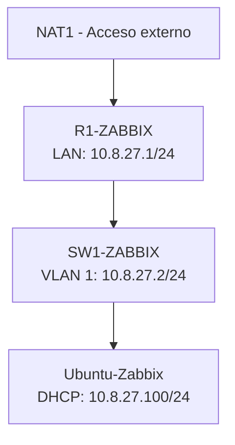

# LABORATORIO DE MONITOREO DE RED CON ZABBIX, DHCP Y SNMP

**Instituto Tecnológico de Las Américas (ITLA)**

**Asignatura:** Seguridad de Redes  
**Estudiante:** Merolyn Mejía Abreu  
**Matrícula:** 2025-0827  
**Tipo de práctica:** Individual  
**Herramientas:** GNS3, Cisco IOS, Ubuntu Server y Zabbix

---

## 🎥 VIDEO DEMOSTRATIVO

**Demostración del funcionamiento completo de la infraestructura:**

[▶️ VER VIDEO DEMOSTRATIVO EN YOUTUBE](PEGAR_AQUI_ENLACE_YOUTUBE)

El video presenta las pruebas de direccionamiento IP, DHCP, configuración SNMP y monitoreo del router y switch mediante Zabbix.

**Duración:** Máximo 10 minutos.

---

## ÍNDICE

1. [Introducción](#1-introducción)
2. [Propósito del laboratorio](#2-propósito-del-laboratorio)
3. [Objetivos](#3-objetivos)
4. [Herramientas utilizadas](#4-herramientas-utilizadas)
5. [Descripción de la infraestructura](#5-descripción-de-la-infraestructura)
6. [Diagrama de la topología](#6-diagrama-de-la-topología)
7. [Direccionamiento IP](#7-direccionamiento-ip)
8. [Configuración del router](#8-configuración-del-router)
9. [Configuración del switch](#9-configuración-del-switch)
10. [Configuración del servidor Ubuntu](#10-configuración-del-servidor-ubuntu)
11. [Implementación de Zabbix](#11-implementación-de-zabbix)
12. [Pruebas de funcionamiento](#12-pruebas-de-funcionamiento)
13. [Medidas de seguridad implementadas](#13-medidas-de-seguridad-implementadas)
14. [Scripts y archivos de configuración](#14-scripts-y-archivos-de-configuración)
15. [Resultados obtenidos](#15-resultados-obtenidos)
16. [Conclusión](#16-conclusión)

---

## 1. INTRODUCCIÓN

En esta práctica se desarrolló una infraestructura de red utilizando GNS3, con el objetivo de implementar servicios de direccionamiento IP, asignación automática de direcciones mediante DHCP y monitoreo de dispositivos utilizando SNMP.

Para supervisar la infraestructura se utilizó Zabbix, una herramienta de monitoreo que permite consultar información de dispositivos de red y visualizar su disponibilidad y rendimiento.

La práctica permitió comprobar el funcionamiento de un router Cisco, un switch Cisco y un servidor Ubuntu integrados en una misma red.

---

## 2. PROPÓSITO DEL LABORATORIO

El propósito principal de este laboratorio es implementar una infraestructura de red que permita administrar y monitorear dispositivos mediante Zabbix y SNMP.

Se busca comprobar que los equipos tienen conectividad, que el servidor DHCP asigna direcciones IP correctamente y que Zabbix puede recopilar información del router y del switch.

Desde el punto de vista de Seguridad de Redes, esta implementación permite conocer el estado de los dispositivos y detectar posibles problemas de disponibilidad o comunicación.

---

## 3. OBJETIVOS

### 3.1 Objetivo general

Implementar una infraestructura de monitoreo utilizando Zabbix y SNMP para supervisar dispositivos Cisco dentro de una red LAN.

### 3.2 Objetivos específicos

- Configurar el direccionamiento IP del router y del switch.
- Implementar un servidor DHCP en el router.
- Configurar comunidades SNMP de solo lectura.
- Configurar Ubuntu Server como cliente DHCP.
- Instalar y utilizar Zabbix Server.
- Registrar el router y el switch en Zabbix.
- Verificar la disponibilidad de los dispositivos.
- Visualizar información y estadísticas mediante SNMP.
- Documentar las configuraciones y pruebas realizadas.

---

## 4. HERRAMIENTAS UTILIZADAS

| Herramienta | Función |
|---|---|
| GNS3 | Simulación de la infraestructura de red |
| Cisco IOS | Configuración del router y switch |
| Ubuntu Server 24.04 LTS | Sistema operativo del servidor |
| Zabbix 7.0 | Monitoreo de los dispositivos |
| SNMPv2c | Consulta de información de red |
| DHCP | Asignación automática de direcciones IP |
| VMware Workstation | Virtualización del servidor |
| Apache y MySQL | Servicios utilizados por Zabbix |

---

## 5. DESCRIPCIÓN DE LA INFRAESTRUCTURA

La infraestructura está formada por cuatro componentes principales.

### NAT1

Permite la conexión de la red del laboratorio hacia el exterior.

### R1-ZABBIX

Router Cisco encargado del direccionamiento de la red LAN, la asignación de direcciones mediante DHCP y la comunicación con la red externa mediante NAT.

También tiene habilitado SNMP para permitir su monitoreo.

### SW1-ZABBIX

Switch Cisco que conecta los dispositivos de la LAN y cuenta con una dirección IP de administración.

Tiene habilitado SNMP de solo lectura para ser supervisado por Zabbix.

### Ubuntu-Zabbix

Servidor Ubuntu que obtiene su dirección IP mediante DHCP y ejecuta Zabbix Server para monitorear los dispositivos Cisco.

---

## 6. DIAGRAMA DE LA TOPOLOGÍA



### Topología implementada en GNS3


La imagen muestra las conexiones entre el nodo NAT, el router, el switch y el servidor Ubuntu.

---

## 7. DIRECCIONAMIENTO IP

Se utilizó el segmento 10.8.27.0/24, basado en la matrícula 2025-0827.

| Dispositivo | Interfaz | Dirección IP | Función |
|---|---|---|---|
| R1-ZABBIX | FastEthernet0/0 | 10.8.27.1/24 | Gateway LAN |
| R1-ZABBIX | FastEthernet1/0 | 192.168.42.90/24 | Conexión NAT |
| SW1-ZABBIX | VLAN 1 | 10.8.27.2/24 | Administración |
| Ubuntu-Zabbix | ens33 | 10.8.27.100/24 | Cliente DHCP |

La dirección WAN del router es dinámica y puede cambiar al renovar DHCP.

---

## 8. CONFIGURACIÓN DEL ROUTER

### 8.1 Direccionamiento IP

El router utiliza FastEthernet0/0 para conectarse a la LAN y FastEthernet1/0 para conectarse a NAT.

Comando de verificación:

```cisco
show ip interface brief
```

**Evidencia:**


Se comprobó que las dos interfaces se encontraban en estado up/up.

### 8.2 Servidor DHCP

El router tiene configurado el pool LAN_ZABBIX para entregar direcciones IP a los dispositivos de la red.

Configuración aplicada:

```cisco
ip dhcp excluded-address 10.8.27.1 10.8.27.99
ip dhcp excluded-address 10.8.27.201 10.8.27.254

ip dhcp pool LAN_ZABBIX
 network 10.8.27.0 255.255.255.0
 default-router 10.8.27.1
 dns-server 8.8.8.8
```

Comandos de verificación:

```cisco
show ip dhcp pool
show ip dhcp binding
```

**Evidencia:**


El comando show ip dhcp binding confirmó la asignación automática de la dirección 10.8.27.100 al servidor Ubuntu.

### 8.3 Comunidad SNMP de solo lectura

Se configuró SNMPv2c para consultar información del router.

La comunidad utiliza permisos RO (Read Only), que permiten realizar consultas sin otorgar permisos de escritura.

La configuración incluye una ACL que restringe las consultas a la red 10.8.27.0/24.

Comandos de verificación:

```cisco
show running-config | include snmp-server
show access-lists 10
show snmp
```

**Evidencia:**


Se comprobaron solicitudes y respuestas SNMP, sin errores de comunidad.

---

## 9. CONFIGURACIÓN DEL SWITCH

### 9.1 Direccionamiento IP

Se configuró la interfaz VLAN 1 con la dirección IP 10.8.27.2/24.

La puerta de enlace del switch es 10.8.27.1.

Configuración aplicada:

```cisco
interface Vlan1
 description ADMINISTRACION_SNMP
 ip address 10.8.27.2 255.255.255.0

ip default-gateway 10.8.27.1
```

Comandos de verificación:

```cisco
show ip interface brief
show vlan brief
```

**Evidencia:**


Se verificó que VLAN 1 estaba activa y que las interfaces conectadas funcionaban correctamente.

### 9.2 Comunidad SNMP

El switch utiliza SNMPv2c con una comunidad de solo lectura y una ACL que permite consultas desde la red LAN.

Comandos de verificación:

```cisco
show running-config | include snmp-server
show snmp
```

**Evidencia:**


El switch registró solicitudes SNMP y respuestas enviadas, confirmando el funcionamiento del protocolo.

---

## 10. CONFIGURACIÓN DEL SERVIDOR UBUNTU

### 10.1 Cliente DHCP

Se utilizó Ubuntu Server 24.04 LTS como sistema operativo del servidor de monitoreo.

La interfaz ens33 fue configurada para obtener automáticamente una dirección IP mediante DHCP.

El servidor recibió:

- Dirección IP: 10.8.27.100
- Máscara: 255.255.255.0
- Gateway LAN: 10.8.27.1

Comandos de verificación:

```bash
ip -4 addr show ens33
ip route
```

**Evidencia:**


### 10.2 Pruebas de conectividad

Desde Ubuntu se verificó la comunicación con el router y el switch.

```bash
ping -c 3 10.8.27.1
ping -c 3 10.8.27.2
```

Estas pruebas permiten comprobar la conectividad entre el servidor y los dispositivos monitoreados.

### 10.3 Servicio Zabbix

Se verificó el funcionamiento del servicio de monitoreo mediante:

```bash
sudo systemctl status zabbix-server
```

El servidor también utiliza Apache y MySQL para proporcionar la interfaz web y almacenar los datos de monitoreo.

---

## 11. IMPLEMENTACIÓN DE ZABBIX

### 11.1 Registro de dispositivos

En Zabbix se registraron los siguientes hosts:

| Host | IP | Protocolo | Plantilla |
|---|---|---|---|
| R1-zabbix | 10.8.27.1 | SNMPv2 | Cisco IOS by SNMP |
| SW1-zabbix | 10.8.27.2 | SNMPv2 | Cisco IOS by SNMP |

Ambos dispositivos pertenecen al grupo Network devices.

### 11.2 Disponibilidad SNMP

Desde Data collection > Hosts se comprobó que los dos dispositivos tenían el indicador SNMP en verde.

**Evidencia:**


### 11.3 Monitoreo del router

En Monitoring > Latest data se consultó la información recopilada del router.

Entre los datos disponibles se observaron:

- Nombre del sistema.
- Descripción del dispositivo.
- Ubicación.
- Contacto administrativo.
- Tiempo de actividad.
- Estado de conectividad ICMP.
- Disponibilidad SNMP.

**Evidencia:**


### 11.4 Monitoreo del switch

También se verificó la información SNMP del switch.

Zabbix permitió consultar:

- Nombre del dispositivo.
- Ubicación.
- Contacto administrativo.
- Tiempo de actividad.
- Estado de disponibilidad.
- Estadísticas de interfaces.

**Evidencia:**


### 11.5 Gráficas de monitoreo

Zabbix permite visualizar gráficas de disponibilidad y otras métricas recopiladas.

En esta práctica se verificó una gráfica de disponibilidad ICMP del router.

**Evidencia:**


---

## 12. PRUEBAS DE FUNCIONAMIENTO

| Prueba | Resultado |
|---|---|
| Interfaces del router | Correcto |
| Dirección IP del switch | Correcto |
| Pool DHCP | Configurado |
| Asignación DHCP a Ubuntu | Exitosa |
| SNMP del router | Funcional |
| SNMP del switch | Funcional |
| Disponibilidad SNMP en Zabbix | Ambos dispositivos disponibles |
| Datos SNMP del router | Recopilados |
| Datos SNMP del switch | Recopilados |
| Gráfica de disponibilidad | Visualizada |

Las pruebas realizadas permitieron comprobar el cumplimiento de los objetivos principales del laboratorio.

---

## 13. MEDIDAS DE SEGURIDAD IMPLEMENTADAS

### 13.1 SNMP de solo lectura

Las comunidades SNMP fueron configuradas con permisos RO para evitar modificaciones mediante dicha comunidad.

### 13.2 Restricción mediante ACL

Se utilizó una lista de control de acceso para permitir consultas SNMP desde la red 10.8.27.0/24.

### 13.3 Separación de funciones

El router proporciona direccionamiento y DHCP, mientras que el servidor Ubuntu realiza el monitoreo mediante Zabbix.

### 13.4 Supervisión de disponibilidad

El monitoreo permite identificar problemas de comunicación o indisponibilidad de los dispositivos.

**Nota de seguridad:** SNMPv2c no cifra la comunidad ni los datos transmitidos. En entornos de producción se recomienda utilizar SNMPv3.

---

## 14. SCRIPTS Y ARCHIVOS DE CONFIGURACIÓN

Los archivos utilizados para documentar y verificar la infraestructura se encuentran organizados en las siguientes carpetas.

### 14.1 Running-config del router

[Ver configuración del router](configuraciones/R1-ZABBIX_running-config.txt)

### 14.2 Running-config del switch

[Ver configuración del switch](configuraciones/SW1-ZABBIX_running-config.txt)

### 14.3 Comandos del router

[Ver comandos del router](scripts/comandos-router.txt)

### 14.4 Comandos del switch

[Ver comandos del switch](scripts/comandos-switch.txt)

### 14.5 Comandos de Ubuntu

[Ver comandos de Ubuntu](scripts/comandos-ubuntu.sh)

Los archivos contienen los comandos de configuración o verificación utilizados en la práctica, según corresponda.

---

## 15. RESULTADOS OBTENIDOS

Durante el desarrollo del laboratorio se lograron los siguientes resultados:

1. Se configuró el direccionamiento IP de la infraestructura.
2. Se implementó un servidor DHCP en el router.
3. Ubuntu obtuvo una dirección IP automáticamente.
4. Se configuró SNMP de solo lectura en el router y switch.
5. Se instaló y configuró Zabbix Server.
6. Se registraron los dispositivos Cisco en Zabbix.
7. Se comprobó la disponibilidad SNMP de ambos dispositivos.
8. Se visualizaron métricas y estadísticas de monitoreo.
9. Se verificó una gráfica de disponibilidad.
10. Se documentó la infraestructura y sus pruebas.

---

## 16. CONCLUSIÓN

Esta práctica permitió implementar una infraestructura de red utilizando GNS3, Cisco IOS, Ubuntu Server y Zabbix.

Se comprobó el funcionamiento del direccionamiento IP, la asignación automática de direcciones mediante DHCP y la configuración de SNMP de solo lectura en los dispositivos Cisco.

Además, mediante Zabbix fue posible monitorear el router y el switch, consultar información de sus sistemas y verificar su disponibilidad.

En conclusión, el laboratorio permitió comprender la importancia del monitoreo de red como herramienta para la administración, supervisión y seguridad de una infraestructura tecnológica.

---

**Instituto Tecnológico de Las Américas (ITLA)**  
**Asignatura:** Seguridad de Redes  
**Estudiante:** Merolyn Mejía Abreu  
**Matrícula:** 2025-0827
