# LABORATORIO DE MONITOREO DE RED CON ZABBIX, DHCP Y SNMP

**Instituto Tecnológico de Las Américas (ITLA)**

**Asignatura:** Seguridad de Redes  
**Estudiante:** Merolyn Mejía Abreu  
**Matrícula:** 2025-0827  


---

# VIDEO DEMOSTRATIVO

### Demostración del funcionamiento de la infraestructura

https://youtu.be/fhHYuoa5eVI

En este video se demuestra el funcionamiento de la topología, el direccionamiento IP, el servidor DHCP, las comunidades SNMP de solo lectura y el monitoreo del router y switch mediante Zabbix.


---

# ÍNDICE

1. [Introducción](#1-introducción)
2. [Propósito del laboratorio](#2-propósito-del-laboratorio)
3. [Objetivos](#3-objetivos)
4. [Herramientas utilizadas](#4-herramientas-utilizadas)
5. [Descripción de la infraestructura](#5-descripción-de-la-infraestructura)
6. [Diseño y diagrama de la topología](#6-diseño-y-diagrama-de-la-topología)
7. [Direccionamiento IP](#7-direccionamiento-ip)
8. [Configuración del router](#8-configuración-del-router)
9. [Configuración del switch](#9-configuración-del-switch)
10. [Configuración del servidor Ubuntu](#10-configuración-del-servidor-ubuntu)
11. [Implementación y monitoreo en Zabbix](#11-implementación-y-monitoreo-en-zabbix)
12. [Pruebas de funcionamiento](#12-pruebas-de-funcionamiento)
13. [Medidas de seguridad implementadas](#13-medidas-de-seguridad-implementadas)
14. [Scripts y archivos de configuración](#14-scripts-y-archivos-de-configuración)
15. [Resultados obtenidos](#15-resultados-obtenidos)
16. [Conclusión](#16-conclusión)

---

# 1. INTRODUCCIÓN

En esta práctica se implementó una infraestructura de red utilizando GNS3, con el objetivo de configurar el direccionamiento IP, un servidor DHCP y el monitoreo de dispositivos mediante el protocolo SNMP.

Para la supervisión de la infraestructura se utilizó Zabbix, una herramienta que permite recopilar información de dispositivos de red y visualizar su disponibilidad y estadísticas.

El laboratorio está compuesto por un router Cisco, un switch Cisco y un servidor Ubuntu, los cuales trabajan en conjunto para demostrar el funcionamiento de los servicios de red y su monitoreo.

---

# 2. PROPÓSITO DEL LABORATORIO

El propósito de este laboratorio es implementar una infraestructura que permita monitorear dispositivos de red mediante Zabbix y SNMP.

A través de esta práctica se busca comprobar que el router y el switch cuentan con direccionamiento IP, que el servidor DHCP asigna direcciones automáticamente y que Zabbix puede consultar información de ambos dispositivos.

Desde el punto de vista de Seguridad de Redes, el monitoreo permite supervisar la disponibilidad de los equipos y detectar posibles problemas de conectividad.

---

# 3. OBJETIVOS

## 3.1 Objetivo general

Implementar una infraestructura de monitoreo utilizando Zabbix y SNMP para supervisar dispositivos Cisco dentro de una red LAN.

## 3.2 Objetivos específicos

- Configurar el direccionamiento IP del router y del switch.
- Implementar un servidor DHCP para la red LAN.
- Configurar comunidades SNMP de solo lectura.
- Configurar Ubuntu Server como cliente DHCP.
- Instalar y configurar Zabbix Server.
- Registrar el router y el switch en Zabbix.
- Verificar la disponibilidad SNMP de ambos dispositivos.
- Visualizar información y estadísticas de monitoreo.
- Documentar las configuraciones y pruebas realizadas.

---

# 4. HERRAMIENTAS UTILIZADAS

| Herramienta | Función |
|---|---|
| GNS3 | Simulación de la infraestructura de red |
| Cisco IOS | Configuración del router y switch |
| Ubuntu Server 24.04 LTS | Sistema operativo del servidor |
| Zabbix 7.0 | Monitoreo de los dispositivos |
| SNMPv2c | Consulta de información de red |
| DHCP | Asignación automática de direcciones IP |
| VMware Workstation | Virtualización del servidor Ubuntu |
| Apache | Servidor web para Zabbix |
| MySQL | Base de datos de Zabbix |

---

# 5. DESCRIPCIÓN DE LA INFRAESTRUCTURA

La infraestructura está compuesta por cuatro elementos principales.

## 5.1 NAT1

Permite proporcionar conectividad externa al router mediante la red NAT de GNS3.

## 5.2 Router R1-ZABBIX

Es el dispositivo encargado de proporcionar conectividad a la red LAN, asignar direcciones IP mediante DHCP y permitir la comunicación con la red externa mediante NAT.

También cuenta con SNMP para permitir su monitoreo.

## 5.3 Switch SW1-ZABBIX

Permite conectar los dispositivos de la red LAN.

Cuenta con una dirección IP de administración y una comunidad SNMP de solo lectura para ser supervisado por Zabbix.

## 5.4 Servidor Ubuntu-Zabbix

Es el servidor encargado de ejecutar Zabbix.

Obtiene su dirección IP automáticamente mediante DHCP y recopila información del router y del switch utilizando SNMP.

---

# 6. DISEÑO Y DIAGRAMA DE LA TOPOLOGÍA

## 6.1 Diseño lógico de la infraestructura

La topología está organizada de forma que el router conecta la red LAN con el nodo NAT, mientras que el switch proporciona conectividad al servidor Ubuntu.

El servidor Zabbix se comunica con los dispositivos Cisco para recopilar información mediante SNMP.

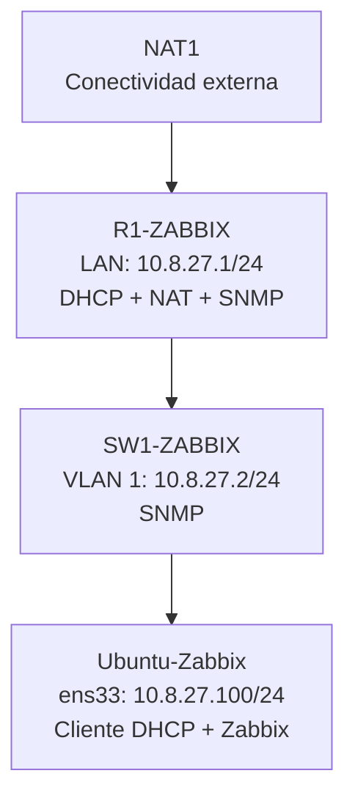

## 6.2 Topología implementada en GNS3

A continuación se presenta la topología desarrollada en GNS3.

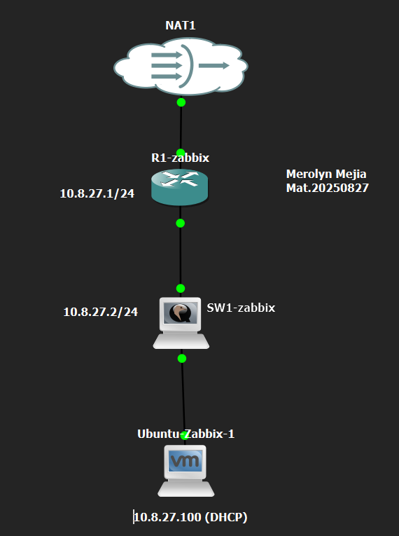

La imagen muestra las conexiones entre NAT1, R1-ZABBIX, SW1-ZABBIX y Ubuntu-Zabbix.

---

# 7. DIRECCIONAMIENTO IP

Para el direccionamiento de la red LAN se utilizó el segmento 10.8.27.0/24, basado en la matrícula 2025-0827.

| Dispositivo | Interfaz | Dirección IP | Función |
|---|---|---|---|
| R1-ZABBIX | FastEthernet0/0 | 10.8.27.1/24 | Puerta de enlace LAN |
| R1-ZABBIX | FastEthernet1/0 | 192.168.42.90/24 | Conexión NAT |
| SW1-ZABBIX | VLAN 1 | 10.8.27.2/24 | Administración |
| Ubuntu-Zabbix | ens33 | 10.8.27.100/24 | Cliente DHCP |

La dirección WAN del router es dinámica, por lo que puede cambiar al renovar su concesión DHCP.

---

# 8. CONFIGURACIÓN DEL ROUTER

## 8.1 Direccionamiento IP del router

El router utiliza la interfaz FastEthernet0/0 para conectarse a la red LAN y FastEthernet1/0 para conectarse al nodo NAT.

Configuración utilizada:

```cisco
interface FastEthernet0/0
 description CONEXION_LAN_SW1_ZABBIX
 ip address 10.8.27.1 255.255.255.0
 ip nat inside
 duplex full

interface FastEthernet1/0
 description CONEXION_INTERNET_NAT
 ip address dhcp
 ip nat outside
 duplex full
```

Comando de verificación:

```cisco
show ip interface brief
```

### Evidencia del direccionamiento

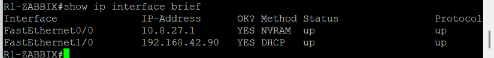

Se comprobó que ambas interfaces estaban activas y funcionando correctamente.

## 8.2 Configuración del servidor DHCP

El router fue configurado para asignar automáticamente direcciones IP a los dispositivos de la LAN.

Configuración aplicada:

```cisco
ip dhcp excluded-address 10.8.27.1 10.8.27.99
ip dhcp excluded-address 10.8.27.201 10.8.27.254

ip dhcp pool LAN_ZABBIX
 network 10.8.27.0 255.255.255.0
 default-router 10.8.27.1
 dns-server 8.8.8.8
```

Comandos de verificación:

```cisco
show ip dhcp pool
show ip dhcp binding
```

### Evidencia del servidor DHCP

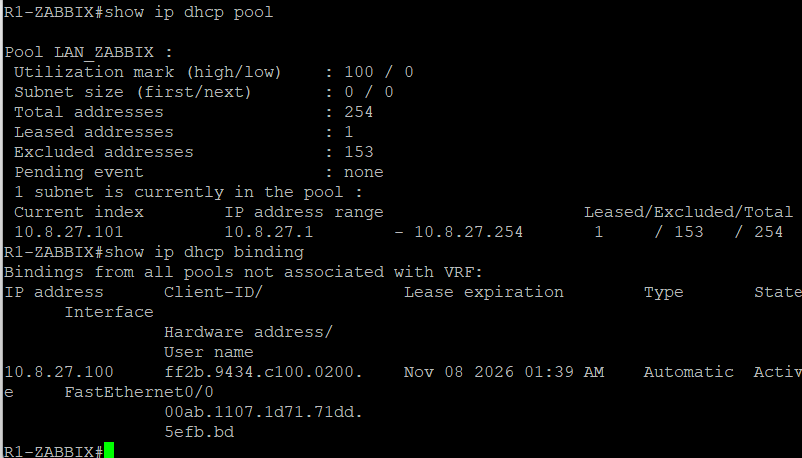

Mediante el comando `show ip dhcp binding` se comprobó que el router asignó automáticamente la dirección IP 10.8.27.100 al servidor Ubuntu.

## 8.3 Configuración SNMP del router

Se configuró SNMPv2c para permitir la recopilación de información del router.

La comunidad utiliza permisos de solo lectura, identificados mediante `RO`.

También se configuró una ACL para restringir las consultas a la red LAN.

Configuración de referencia con la comunidad redactada:

```cisco
access-list 10 permit 10.8.27.0 0.0.0.255

snmp-server community COMUNIDAD_SNMP_REDACTADA RO 10
snmp-server location LAB_GNS3_ITLA
snmp-server contact Administrador_Redes
```

Comandos de verificación:

```cisco
show snmp
show access-lists 10
```

### Evidencia SNMP del router

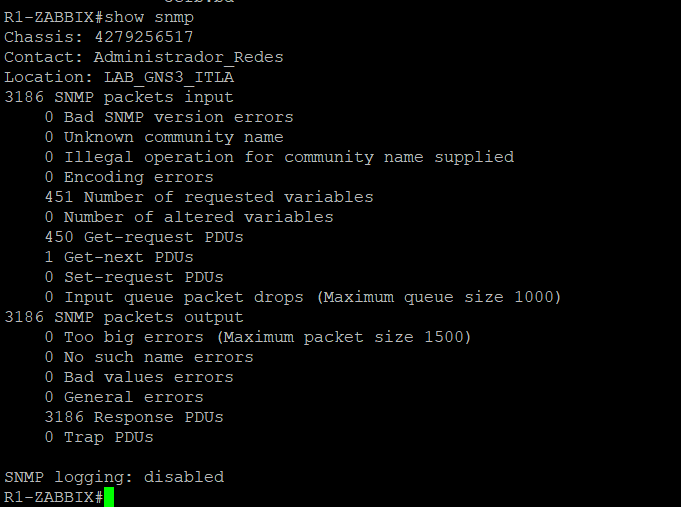

Se verificó que el router recibía solicitudes SNMP y enviaba respuestas correctamente.

## 8.4 Configuración NAT del router

Para proporcionar conectividad externa a la LAN, se implementó NAT con sobrecarga.

Configuración aplicada:

```cisco
ip access-list standard NAT_LAN
 permit 10.8.27.0 0.0.0.255

ip nat inside source list NAT_LAN interface FastEthernet1/0 overload
```

Comando de verificación:

```cisco
show ip nat statistics
```

---

# 9. CONFIGURACIÓN DEL SWITCH

## 9.1 Direccionamiento IP del switch

El switch utiliza la interfaz VLAN 1 como interfaz de administración.

Configuración aplicada:

```cisco
interface Vlan1
 description ADMINISTRACION_SNMP
 ip address 10.8.27.2 255.255.255.0

ip default-gateway 10.8.27.1
```

Comandos de verificación:

```cisco
show ip interface brief
show vlan brief
```

### Evidencia del direccionamiento

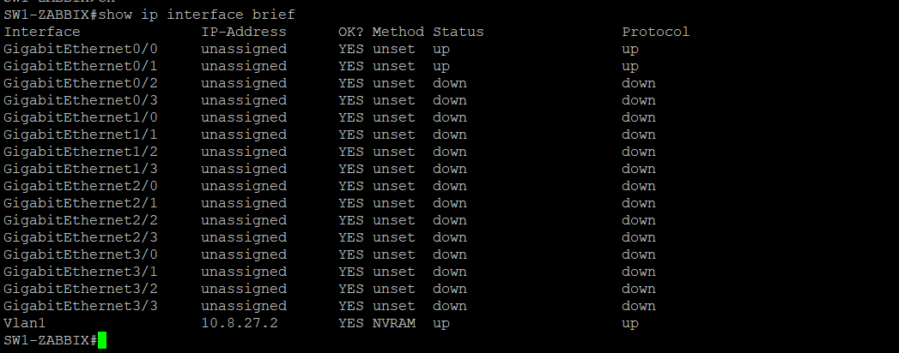

Se comprobó que la interfaz VLAN 1 estaba activa con la dirección 10.8.27.2.

También se verificó el estado de las interfaces GigabitEthernet conectadas.

## 9.2 Configuración SNMP del switch

El switch fue configurado con SNMPv2c y una comunidad de solo lectura.

Configuración de referencia con la comunidad redactada:

```cisco
access-list 10 permit 10.8.27.0 0.0.0.255

snmp-server community COMUNIDAD_SNMP_REDACTADA RO 10
snmp-server location LAB_GNS3_ITLA
snmp-server contact Administrador_Redes
```

Comando de verificación:

```cisco
show snmp
```

### Evidencia SNMP del switch

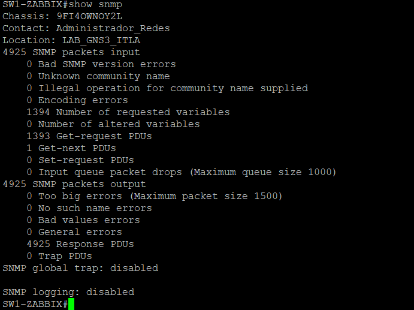

Se comprobó que el switch recibía consultas SNMP y enviaba respuestas, confirmando el funcionamiento del protocolo.

---

# 10. CONFIGURACIÓN DEL SERVIDOR UBUNTU

## 10.1 Cliente DHCP

Se utilizó Ubuntu Server 24.04 LTS para ejecutar Zabbix Server.

La interfaz ens33 fue configurada para obtener automáticamente una dirección IP mediante DHCP.

El servidor recibió la dirección 10.8.27.100/24 desde el router.

Comandos de verificación:

```bash
ip -4 addr show ens33
ip route
```

### Evidencia del cliente DHCP

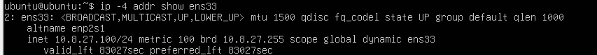

Se comprobó que el servidor Ubuntu tenía asignada una dirección IP perteneciente a la red LAN.

## 10.2 Pruebas de conectividad

Se realizaron pruebas de comunicación desde Ubuntu hacia el router y el switch.

```bash
ping -c 3 10.8.27.1
ping -c 3 10.8.27.2
```

Estas pruebas permiten verificar la comunicación entre los dispositivos de la infraestructura.

## 10.3 Verificación del servicio Zabbix

Se verificó el estado del servicio de monitoreo.

```bash
sudo systemctl status zabbix-server
```

También se utilizaron Apache y MySQL para el funcionamiento de la plataforma web y su base de datos.

---

# 11. IMPLEMENTACIÓN Y MONITOREO EN ZABBIX

## 11.1 Registro de dispositivos

En Zabbix se registraron los dispositivos Cisco como hosts de monitoreo.

| Host | Dirección IP | Protocolo | Plantilla |
|---|---|---|---|
| R1-zabbix | 10.8.27.1 | SNMPv2 | Cisco IOS by SNMP |
| SW1-zabbix | 10.8.27.2 | SNMPv2 | Cisco IOS by SNMP |

Ambos dispositivos fueron agregados al grupo `Network devices`.

## 11.2 Verificación de disponibilidad SNMP

Desde la sección:

**Data collection > Hosts**

Se comprobó que los dispositivos tenían disponibilidad SNMP.

### Evidencia de hosts monitoreados

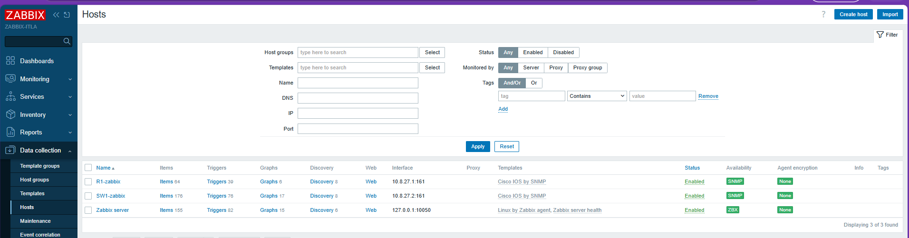

Ambos dispositivos aparecieron con el indicador SNMP en verde, confirmando que Zabbix podía comunicarse con ellos.

## 11.3 Monitoreo del router R1-ZABBIX

Desde:

**Monitoring > Latest data > R1-zabbix**

Se verificaron diferentes datos del router, incluyendo:

- Nombre del sistema.
- Descripción del dispositivo.
- Ubicación.
- Contacto administrativo.
- Tiempo de actividad.
- Estado de conectividad ICMP.
- Disponibilidad SNMP.

### Evidencia del monitoreo del router

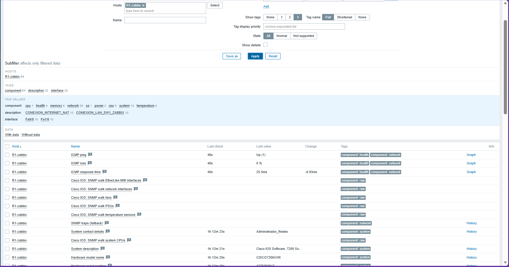

La información recopilada permitió comprobar que Zabbix estaba monitoreando correctamente el router.

## 11.4 Monitoreo del switch SW1-ZABBIX

Desde:

**Monitoring > Latest data > SW1-zabbix**

Se verificó la información recopilada del switch.

Entre los datos disponibles se encontraron:

- Nombre del dispositivo.
- Ubicación.
- Contacto administrativo.
- Tiempo de actividad.
- Disponibilidad del dispositivo.
- Estadísticas de interfaces.

### Evidencia del monitoreo del switch

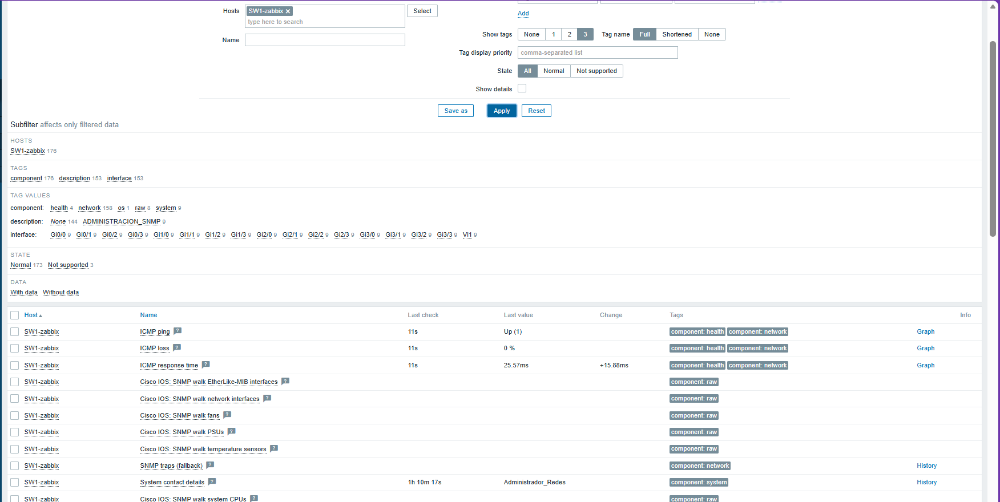

Se comprobó que Zabbix recibía información del switch mediante SNMP.

## 11.5 Gráficas de monitoreo

Zabbix permite representar gráficamente los datos recopilados de los dispositivos.

En esta práctica se verificó una gráfica de disponibilidad ICMP del router.

### Evidencia de la gráfica

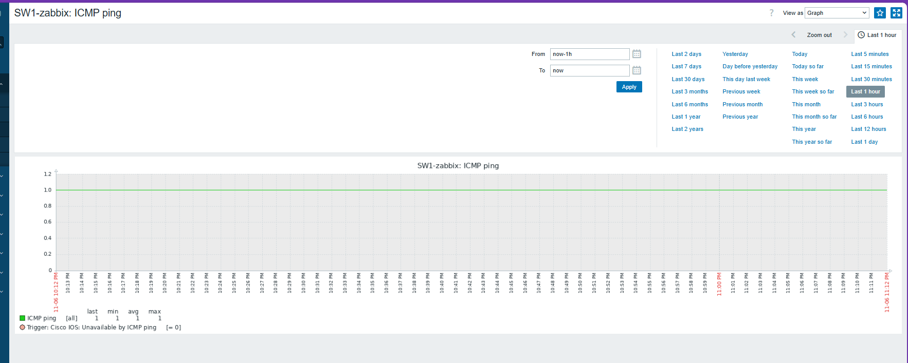

Esta gráfica permite observar el estado de conectividad del dispositivo durante el período seleccionado.

---

# 12. PRUEBAS DE FUNCIONAMIENTO

Durante la práctica se realizaron pruebas para comprobar que la infraestructura cumplía los requisitos solicitados.

| Prueba realizada | Resultado |
|---|---|
| Direccionamiento IP del router | Correcto |
| Direccionamiento IP del switch | Correcto |
| Interfaces LAN activas | Correcto |
| Servidor DHCP del router | Funcional |
| Asignación de IP a Ubuntu | Exitosa |
| Comunidad SNMP de solo lectura en R1 | Configurada |
| Comunidad SNMP de solo lectura en SW1 | Configurada |
| Consultas SNMP al router | Exitosas |
| Consultas SNMP al switch | Exitosas |
| Registro de dispositivos en Zabbix | Completado |
| Disponibilidad SNMP en Zabbix | Ambos disponibles |
| Datos SNMP del router | Recopilados |
| Datos SNMP del switch | Recopilados |
| Gráfica de disponibilidad | Visualizada |

Los resultados obtenidos demuestran el funcionamiento de los servicios implementados.

---

# 13. MEDIDAS DE SEGURIDAD IMPLEMENTADAS

## 13.1 SNMP de solo lectura

Las comunidades SNMP fueron configuradas con permisos `RO`, evitando modificaciones mediante dichas comunidades.

## 13.2 Restricción de acceso mediante ACL

Se configuró una ACL que limita las consultas SNMP a la red 10.8.27.0/24.

## 13.3 Separación de funciones

El router proporciona conectividad y DHCP, mientras que Ubuntu ejecuta Zabbix para realizar el monitoreo.

## 13.4 Supervisión de disponibilidad

El monitoreo de los dispositivos permite identificar problemas de conectividad y disponibilidad.

## 13.5 Consideraciones de seguridad

SNMPv2c no proporciona cifrado de la comunidad ni de la información transmitida.

Para entornos de producción se recomienda utilizar SNMPv3, debido a sus mecanismos de autenticación y cifrado.

---

# 14. SCRIPTS Y ARCHIVOS DE CONFIGURACIÓN

Para documentar la infraestructura se organizaron los archivos de configuración y los comandos utilizados.

## 14.1 Running-config del router

[Ver running-config de R1-ZABBIX](configuraciones/R1-ZABBIX_running-config.txt)

## 14.2 Running-config del switch

[Ver running-config de SW1-ZABBIX](configuraciones/SW1-ZABBIX_running-config.txt)


---

# 15. RESULTADOS OBTENIDOS

Durante el desarrollo del laboratorio se obtuvieron los siguientes resultados:

1. Se implementó una infraestructura de red en GNS3.
2. Se configuró el direccionamiento IP del router y del switch.
3. Se implementó un servidor DHCP para la red LAN.
4. Ubuntu obtuvo automáticamente la dirección IP 10.8.27.100.
5. Se configuraron comunidades SNMP de solo lectura.
6. Se verificó el funcionamiento de SNMP en ambos dispositivos Cisco.
7. Se instaló y configuró Zabbix Server.
8. Se registraron el router y el switch como hosts.
9. Se comprobó la disponibilidad SNMP de ambos dispositivos.
10. Se visualizaron datos y gráficas de monitoreo.

---

# 16. CONCLUSIÓN

Esta práctica permitió implementar una infraestructura de monitoreo de red utilizando GNS3, Cisco IOS, Ubuntu Server y Zabbix.

Se comprobó el funcionamiento del direccionamiento IP, la asignación automática de direcciones mediante DHCP y las comunidades SNMP de solo lectura configuradas en los dispositivos Cisco.

También se logró integrar el servidor Ubuntu con Zabbix para supervisar el router y el switch, consultar sus datos y verificar su disponibilidad.

En conclusión, el laboratorio permitió comprender la importancia del monitoreo de red como herramienta para la administración, supervisión y seguridad de una infraestructura tecnológica.

---

**Instituto Tecnológico de Las Américas (ITLA)**  
**Asignatura:** Seguridad de Redes  
**Estudiante:** Merolyn Mejía Abreu  
**Matrícula:** 2025-0827
